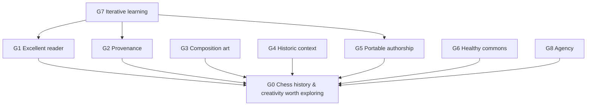
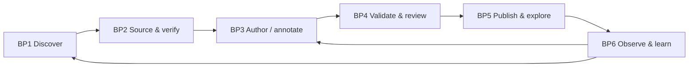

# 4EM enterprise model — Chess Anthology

**Model status:** proposed TO-BE model. It models the undertaking (an open creative community plus two products), **not** a legal company or current staffed organization. IDs permit explicit cross-model traceability into delivery.

4EM / *For Enterprise Modeling* uses interlinked models of **Goals, Business Rules, Concepts, Business Processes, Actors & Resources, and Technical Components & Requirements**. Some current 4EM tools include a seventh Products & Services view; we represent that as an explicit extension. References: [OMiLAB 4EM](https://code.omilab.org/resources/modelling_tools/4em), [Lantow, Sandkuhl & Stirna (2022)](https://research.rtu.lv/en/publications/enterprise-modeling-with-4em-perspectives-and-method/), [research overview](https://pmc.ncbi.nlm.nih.gov/articles/PMC7254533/).

## 0. Scope, environment, and current → desired situation

**Environment:** chess players, composers and their estates; historic records and composition archives; educators and authors; open-source contributors; web technologies; copyright/licensing and accessibility expectations. Chess artifacts may be public facts, but accompanying annotations, photography, original solution writeups, and database compilations can have distinct rights.

**AS-IS (observed inspiration, not comprehensive market research):** Historical chess sources, databases, lectures, games, and composition resources exist, but discovery, interactive narrative context, authorship metadata, and portable publishing are fragmented. Some commercial experiences optimize dramatic packaging rather than scholarly or editorial care.

**TO-BE:** Readers can discover and interact with both authentic historical games and human-authored compositions, trace their origin, optionally explore an original narrative, and carry portable content between tools. Contributors can improve the commons. This represents a desired outcome to test.

## 1. Goals model (G)

| ID | Goal | Supports / evaluation |
| --- | --- | --- |
| **G0** | Make chess history and human creative work rewarding to explore | Mission; creator and reader judgment |
| **G1** | Create an excellent, self-directed interactive reading experience | G0; observed usability, voluntary return |
| **G2** | Preserve historical accuracy and transparent provenance | G0; cited facts, uncertainty and attribution review |
| **G3** | Make composition artistry and authorship visible | G0; composer, stipulation, intended solution and thematic explanation |
| **G4** | Make meaningful historical context navigable | G0; connected games, events, places, people and eras |
| **G5** | Support open, portable human/agent-assisted authorship | G0; content export/import and reproducible validation |
| **G6** | Sustain a healthy contributor and maintenance community | G0; clear decisions, accessible work, manageable work-in-progress |
| **G7** | Learn through repeated playable, research-backed product experiments | G1–G6; evidence changes decisions |
| **G8** | Protect reader and contributor agency | G0; opt-in prompts, consent/attribution and no manipulative engagement |

### Problem / opportunity / constraint model

- **P1:** Ordinary chess products often teach winning or optimize engagement rather than historical curiosity. Motivates G1/G4.
- **P2:** Archives and websites separate records, authors, commentary, and interactive visualization. Motivates G2/G5.
- **P3:** Generative content can fabricate chess moves, history, citations, or an emotional tone alien to the original work. Motivates G2/G3.
- **P4:** Premature framework and community complexity can displace craft and maintenance. Threatens G1/G6.
- **O1:** PGN/FEN and existing chess libraries offer interoperable foundations. Enables G5.
- **O2:** Historians, composition catalogs, original archives and knowledgeable volunteers offer source material and editorial guidance. Enables G2–G4.
- **C1:** Source/reuse rights and licenses must be respected.
- **C2:** User agency, accessibility, and open export are design constraints.
- **C3:** The project initially has limited people, budget, time and verified content.

## 2. Business rules model (BR)

Here "business rules" means **project/editorial and community constraints**, not sales policies.

| Rule | Rule statement | Motivated by |
| --- | --- | --- |
| **BR1** | Every curated historical assertion carries an inspectable source or an explicit uncertainty label. | G2 |
| **BR2** | Distinguish a recorded game, composed problem, hypothetical variation, and reconstructed narrative. | G2/G3 |
| **BR3** | Curated compositions display author attribution (or an uncertainty notice), stipulated objective, source where known, and intended solution. | G2/G3 |
| **BR4** | Validate game moves, replay anchors, and suggested challenge answers mechanically before publication; use composition-aware verification as needed. | G1/G2/G3 |
| **BR5** | A generated artifact is labeled as unreviewed until the relevant evidence and chess checks pass. | G2/G5 |
| **BR6** | Preserve source/licensing notes; never assume web availability equals redistribution permission. | G2/G6 |
| **BR7** | Avoid compulsory streaks, engagement penalties and monetized attentional pressure. | G1/G8 |
| **BR8** | Readers can skip, replay, inspect, pause, mute, and leave a lesson without losing access to the artifact. | G1/G8 |
| **BR9** | Architectural and community rules stay lightweight, public and amendable; contributors can propose changes. | G6 |
| **BR10** | Ensure the two product identities remain editorially distinct even if software is shared. | G3/G4 |
| **BR11** | Record uncertainty, failed validation, alternate attributions and corrections instead of silently rewriting the record. | G2/G6 |

## 3. Concepts model (C)

| Concept | Meaning and key relations |
| --- | --- |
| **Project** | Chess Anthology; stewards two distinct **Products** |
| **Product** | Chess Through History or The Art of Chess Composition |
| **Artifact** | Abstract, attributable chess work; specialized as **Recorded Game** or **Composition** |
| **Recorded Game** | Historical players, moves (PGN), event, date/site where evidenced, competing source records |
| **Composition** | Author(s), initial position (FEN), stipulation, intended solution, soundness status, publication/version |
| **Person** | Player, composer, editor, historian; one person can hold several roles |
| **Event / Era / Collection** | Organizational and contextual groupings; a work can belong to multiple collections |
| **Position / Move / Variation** | Mechanically legal (subject to applicable chess variant/rules) chess state and continuation |
| **Narrative** | Authored interpretation of artifacts and context; not identical with the archival artifact |
| **Story Beat** | Narrative segment bound to a source, board state, optional media or interaction |
| **Interaction** | Replay, prediction, hint, branch, inspection, reveal |
| **Source** | Bibliographic record/URI, type, citation detail, rights information |
| **Claim** | Historical assertion connected to sources, a confidence/status and correction history |
| **Contribution** | Proposed change to code or curated content with review and attribution |
| **Import** | External or agent-proposed artifact; requires normalization and validation |

Key distinctions: **game ≠ composition**; **record ≠ interpretation**; **source ≠ license**; **human author ≠ AI processing agent**; **collection ≠ compulsory course**.

## 4. Business process model (BP)

| Process | Input → outcome | Main responsibility |
| --- | --- | --- |
| **BP1 Discover** | Reader question, collection theme → candidate artifacts and story | Researcher/editor or optional agent |
| **BP2 Source & verify** | Candidate record → checked chess data, provenance, rights notes | Researcher + chess verifier |
| **BP3 Author / annotate** | Verified artifact → original beats, hints, optional sound/media | Human editor/creator; agents may draft |
| **BP4 Validate & review** | Draft → accepted, corrected, held, or rejected publication | Automated checks + human editorial review |
| **BP5 Publish & explore** | Accepted artifact → accessible reader and portable export | Maintainer / reader |
| **BP6 Observe & learn** | Usability, factual corrections, contributor needs → revised hypotheses/tickets | Steward + contributors |

Not every artifact needs a full narrative; imported material can be playable with explicit unreviewed status.

## 5. Actors and resources model (AR)

| Actor / resource | Responsibilities, rights, dependencies |
| --- | --- |
| **AR1 Reader** | Explores, chooses modes, provides optional feedback; owns their attention and local imports |
| **AR2 Author/editor** | Creates the story, selects evidence and tone; receives credit and review feedback |
| **AR3 Historical researcher** | Verifies factual context, attribution, dates and citations |
| **AR4 Chess/composition reviewer** | Checks move validity, stipulations, intended variations, cooks/duals and rulesets |
| **AR5 Maintainer/technical lead** | Integrates reliable software, chooses reversible architecture, protects quality |
| **AR6 Project steward** | Coordinates mission, editorial identity, permissions, and open governance |
| **AR7 AI research agent** | Discovers, imports, structures, drafts; **not an accountable historical authority** |
| **AR8 External creator/rights holder** | Supplies or controls third-party materials; attribution and license restrictions matter |
| **Resources** | Public-domain and licensed archives; PGNs/FENs; source records; review time; open libraries; media and hosting budget |

Roles are **capabilities**, not paid positions or assumed people. One contributor may fill multiple roles. Contributors should have meaningful voice in their work; stewardship should not suppress correction or dissent.

## 6. Technical components and requirements (TR / TC)

Technology below is a *capability contract*, not a selected stack.

| ID | Requirement / quality attribute | Supports | Candidate capability |
| --- | --- | --- | --- |
| **TR1** | Replay moves and chess positions correctly, including legal variations | G1/G2 | TC1 chess rules + PGN/FEN |
| **TR2** | Support progressively disclosed hints, rewind, free exploration and prediction | G1/G8 | TC2 interactive board + lesson state |
| **TR3** | Represent a composition's stipulation, intended solution and verification context | G3 | TC3 composition document / verifier |
| **TR4** | Bind authored prose/media to stable positions/variation branches | G1/G4 | TC4 narrative beat timeline |
| **TR5** | Carry citations, creator identity, source confidence and rights metadata | G2 | TC5 provenance metadata |
| **TR6** | Import/export readable artifacts without a proprietary account | G5/G8 | TC6 file-based content and validator |
| **TR7** | Allow optional agent-proposed import with review before curation | G2/G5 | TC7 import adapter, optional |
| **TR8** | Work well without audio, without animation, on keyboard/touch and with assistive tech | G1/G8 | TC8 accessible presentation |
| **TR9** | Run deterministic chess and content QA in CI and on contributed materials | G2/G6 | TC9 tests, schema checks and review |
| **TR10** | Support links among games, people, compositions and collections | G4 | TC10 simple local links/index first |

**Out of initial scope:** mandatory LLM calls, accounts, global recommendation service, graph server, monetization, multi-board simul viewer, full endgame-composition engine, or permanent user analytics. Revisit if tested demands require them.

## 7. Products and services view (4EM extension)

| Product | Reader outcome | Main goals | Candidate first slice |
| --- | --- | --- | --- |
| **Chess Through History** | Understand an actual game *in context* and make a few meaningful moves | G1/G2/G4/G8 | Morphy–Brunswick/Isouard Opera Game |
| **The Art of Chess Composition** | Appreciate a deliberately constructed work, its author and solution | G1/G2/G3/G8 | Morphy-attributed 1856 mate-in-two |
| **Shared public contribution** | Create/import/export inspectable interactive chess literature | G5/G6 | local import and portable narrative document |

## 8. Traceability into SDLC

| Strategic intent | Rule | Process | Requirement | Verifiable first-slice evidence |
| --- | --- | --- | --- | --- |
| G2 provenance | BR1, BR11 | BP2, BP4 | TR5 | Every displayed historical claim links to a source or uncertainty note |
| G3 composition appreciation | BR2–BR4 | BP2–BP5 | TR3 | Mate-in-two has stipulated answer, defenses and verified intended line |
| G1 reader quality | BR8 | BP3, BP5–BP6 | TR1, TR2, TR4 | New reader can explore, replay, ask for hints and leave freely |
| G5 openness | BR5–BR6 | BP2–BP5 | TR6 | Export/import of initial artifact reproduces board, metadata and narrative |
| G6 maintainability | BR9 | BP4–BP6 | TR9 | CI guards correctness; an external contributor can run it |

**Interpretation boundary:** 4EM is a *model of why and how the project operates*. It is not the code architecture or a substitute for the technical lead's architecture decisions. Update it when experiments challenge its assumptions.