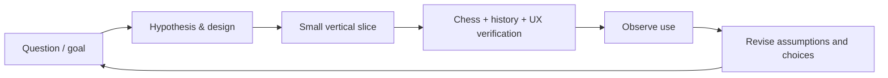

# Discovery → software development: iterative delivery strategy

Use **product experiments and integrated vertical slices**, rather than a single waterfall specification or building infrastructure layer by layer.

## Method synthesis

- **Double Diamond**: Diverge to understand the experience and competing approaches; converge on a testable slice; repeat, don't treat discovery as closed.
- **Effectuation**: Start with available people, skills, curiosity, and affordable risk; don't require an upfront revenue forecast.
- **Lean Startup (used cautiously)**: Make core assumptions falsifiable; observe how people use a real artifact. Do not replace editorial judgment with engagement analytics.
- **Shape Up**: Define an effort appetite and out-of-bounds features; shrink scope to fit, keep craftsmanship intact.
- **Human-centred design**: Learn from real readers and whole-task interactions, including accessibility and context of use.
- **Continuous delivery**: Keep the integrated application working with automated validation, preview deploys, small reversible changes.

These are **methods to choose from**, not simultaneous process mandates or evidence that the product is commercially viable. [References](REFERENCES.md).

## Delivery loop

Every cycle should produce an artifact that can be opened, played and judged. Put a reason, risk, acceptance criteria and review result on each Ticket. Prefer a **single playable tracer bullet** spanning content, chess state, UI and verification over separate unfinished subsystems.

## Provisional slices (sequence, not release promises)

| Slice | Vertical result | What it de-risks |
| --- | --- | --- |
| **S0 Product brief + design explorations** | Realistic screen prototypes using verified sample positions | Whether story and board can coexist attractively |
| **S1 Composition** | A complete sourced Morphy-attributed mate-in-two with a playable board, meaningful hints, solution and optional notes | Correctness, narrative pacing, interaction feel, provenance |
| **S2 Historic game** | Full Opera Game replay plus contextual story and 1–2 move predictions | Game-tree anchors, variation UX, history vs inference, shared reader |
| **S3 Local import** | Reader accepts real PGN and FEN with source metadata, preserves local content, distinguishes unreviewed from curated | Portability, document contract, correctness |
| **S4 Optional agent research** | Given a composer/event query, propose independently inspectable sourced artifacts for review and import | Retrieval reliability and human agency |
| **S5 Small community release** | Public previews, contributor guide, first external feedback, open code + clearly licensed content | Reproducibility, maintenance and stewardship |

Do not build S4/S5 before S1/S2 demonstrate intrinsic value.

## Quality gates for any content slice

1. **Chess:** All moves and anchors legal under specified rules; challenge answers and relevant branches validated; composition stipulation and intended solution reviewed.
2. **History:** Factual claims cited; disputed attributions labeled; original game versus constructed problem unambiguous.
3. **Editorial:** A reader can explain what is interesting and why; no generic content padding.
4. **Experience:** Board readable, sound optional, responsive keyboard/pointer/touch, no trapping or compulsory quizzes, reduced-motion support.
5. **Maintainability:** Automated tests for chess and content assertions, a reproducible local run, changes small and reviewable.
6. **Rights:** Media and source licensing known or absent; attribution visible.

## Experiment evidence (not growth dashboards)

- Reader can open and complete/explore a slice with no onboarding.
- Reader understands the chess mechanism and one meaningful human/historical context point.
- Reader can find source/certainty notes and distinguish authorship from machine assistance.
- Creator chooses to reopen the app voluntarily; record subjective reasons, not just usage counts.
- Contribution/import path preserves provenance and is understandable to a newcomer.
- Record negative results, confusion, and rejected features.

Three to five exploratory usability sessions are enough to find *some* serious interface failures, not enough to validate wide demand. Also self-test frequently: the creator is a target user, not the only credible audience.

## Workflow and artifacts

- **Project brief / 4EM**: Intent and constraints, updated infrequently with reason.
- **Product/experience brief**: Reader promise and editorial requirements.
- **Experiment brief**: One risk, one integrated testable slice and exclusions.
- **Tickets**: Thin changes linked to a slice and relevant goal/requirement IDs.
- **ADRs**: Consequential architecture decisions with options and reversibility.
- **Test evidence**: CI, chess checks, attribution audit, observed usability.
- **Release/correction notes**: What changed for readers and what remains uncertain.

Every completed slice must update the app and the relevant evidence; documentation is not progress in place of a running product.

## Scope discipline

Do not build a full 4EM modeling tool, knowledge-graph service, generic course builder, analytics warehouse, user accounts, recommendation feed, or publisher marketplace just because they fit a possible future vision. The small vertical slice determines what capabilities really need to be shared.